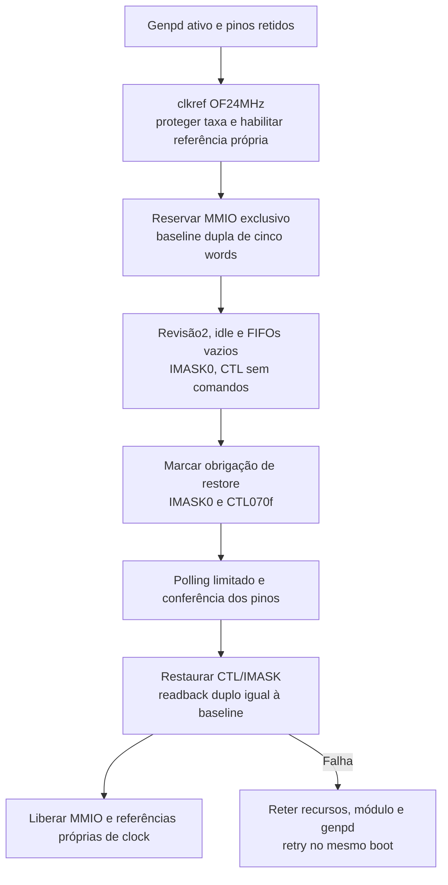

# Controlador I2C1 por polling

## Estado

Fase1 em609dd39 e fase2 emd226603/45a3aa5: MMIO/clkref, baseline, reset/restauração de revisão2 e owner operacional de GPIO/pinctrl integrados ao novo action configure. Ainda não foram executados no aparelho. Os probes de compilação retornam ENODEV no init; o módulo operacional é um artefato distinto, cujo init run1 apenas qualifica. SN2400, gauge e carga Linux continuam sem prova física. [Plano](../.agents/plans/n71-i2c-controller.md), [D37/D38/D39](../.agents/plans/n71-funcional-goal-decisoes.md#d37-inicializar-i2c1-por-polling-com-restauração-própria), [fase1](evidence/n71-i2c-controller-reset.json), [fase2](evidence/n71-i2c-configure-qualified.json).

A [leitura HDQ limitada](N71_I2C_HDQ_READ.md), em3e0a597/93da4be, acrescenta um transporte opt-in e recovery retido. A igualdade integral descrita abaixo continua sendo o contrato de configure sem transferência; depois de consumir SMSTA/XEN, somente esse evento histórico é removido da comparação, mantendo a baseline original. Provas e artefatos abaixo pertencem às fases históricas identificadas; a nova candidata tem manifesto/build próprios.

O código só poderá ser chamado com consumidor N71/I2C1 já qualificado pelo backend genpd e descriptors realmente retidos. O chamador serializa comandos e mantém módulo, consumidor, OF, pinos e domínio ativo até `n71_i2c_controller_clean` comprovar ausência de recursos/obrigação. O callback `verify_pins` deve validar a reserva e o readback atual; a fixture de testes não é uma implementação física desse callback.

## Sequência e falhas



Recurso exato20a111000/1000, consumidor root sem bus/driver/pm_domain. Clock por único phandle OF para `/clock-ref`, fixed-clock com cells0 e24MHz; taxa real deve corresponder. O header protege a taxa e balanceia apenas suas referências. Outro consumidor pode manter o clock habilitado após o release. A contabilidade pertence ao [Common Clk Framework](https://docs.kernel.org/driver-api/clk.html); as APIs e os hashes da versão efetivamente usada constam na evidência.

Baseline lê REV28, SMSTA14, XFSTA0c, IMASK18 e CTL1c duas vezes. All-ones, drift, revisão diferente de2, status ocupado/com RX pendente/TX não vazio, XFSTA nãozero, IMASK nãozero ou CTL com bits fora do divisor baixo recusam a escrita. IMASK nãozero poderia reativar interrupções herdadas; CTL com bits de comando não seria seguro para replay de restore.

O reset segue a fonte PASemi fixada: CTL070f contém MTR/MRR/UJM e divisor15 para24MHz/(16×100kHz). Não inclui EN usado a partir da revisão6. A condição aceita após reset é CTL0f ou070f com as outras quatro words idênticas à baseline. O código não presume que os command bits se limpem sozinhos. São condições ainda a conferir no hardware. Não escreve SMSTA, FIFO, carregador ou limites de corrente; reset pode ter efeitos elétricos e não comprova carga.

O polling usa no máximo100 esperas nominais de1ms, além das leituras; não há promessa de prazo absoluto para backend bloqueado. Release requer domínio ativo, callback de pinos e amostra estável/idle com CTL dentro da máscara conhecida07ff. Só então escreve CTL/IMASK originais e exige igualdade dupla das cinco words. Falha conserva os recursos, `restore_pending` e `cleanup_error`; acquire preserva o erro primário separado. Normal unload do futuro caller precisa permanecer bloqueado enquanto houver cleanup pendente. Force unload não será uma recuperação suportada.

## Provas executadas

| Gate | Resultado | Limite |
| --- | --- | --- |
| Mac, header real com APIs sintéticas | 50 cenários;15 mutações por SIGABRT/asserção | Sem hardware |
| Ubuntu ARM64, mesmos cinco inputs | 50 cenários;15 mutações por SIGABRT/asserção | Sem hardware |
| Probe kernel W=1/KCFLAGS-Werror/modpost | 11.192bytes;26 imports presentes nos exports;ELF64/AArch64;vermagic power2 | Probe recusa load; não é caller operacional |
| Checkpatch estrito | 0erros/0avisos/0checks | Estilo do header |
| AST/lint fatal Python | Verdes no Mac/ARM64 | Não há type checker Python configurado |
| Config/Image/exports preservados | Hashes iguais antes/depois | Não houve rebuild de Image |

Testes cobrem escopo MMIO/clock, falha de aquisição/enable, outro consumidor de clock, baseline inválida, readback, timeout, erro primário distinto de cleanup, estado pending, retry e release idempotente. Um mutante de escopo MMIO sobreviveu à primeira fixture porque o cenário mudava também o tamanho; o teste foi corrigido para deslocar início/fim juntos e agora mata esse guard removido. Isso é correção da prova, não falha física do controlador.

O build preservado não tem Module.symvers agregado; modpost emite seu aviso genérico. O comando fornece `vmlinux.symvers` via KBUILD_EXTRA_SYMBOLS e os26 imports foram confrontados individualmente com ele, sem ausências. Não foi usado KBUILD_MODPOST_WARN nem criado arquivo no build preservado para esconder o aviso. O probe é uma unidade separada, com init que recusa load; nenhum perfil ou módulo operacional foi substituído.

## Reprodução

Na árvore do projeto, com o compilador já disponível:

```sh
python3 -B -m unittest discover -s tests -p test_n71_i2c_controller.py -v
```

O runner compila o header real e cada mutação com gnu11/Wall/Wextra/Werror. Erros de compilação, crashes sem asserção e timeouts não contam como kill. O fixture nunca transmite I2C e não usa o aparelho.

Para o probe, usar a VM dedicada já preparada conforme [build fonte](KERNEL-SOURCE-BUILD.md) e [bundle preservado](N71_KERNEL_BUNDLE.md). Copiar somente os três headers para uma pasta nova de módulos, sem modificar source/output do kernel. No exemplo abaixo, mudar `module_dir` caso já exista:

```sh
set -eu
umask 077
work_dir=/home/ubuntu/kernel-n71-binding-source-20261005
build_dir=/home/ubuntu/kernel-n71-binding-build-20261005
module_dir=/home/ubuntu/n71-i2c-controller-reproduction/probe
test ! -e "$module_dir" && test ! -L "$module_dir"
mkdir -p "$module_dir"
cp phone/kernel/n71-i2c-controller.h \
   phone/kernel/n71-i2c-controller-observe.h \
   phone/kernel/n71-i2c-power-lifecycle.h "$module_dir/"
cat > "$module_dir/Makefile" <<'EOF'
obj-m += n71-controller-build-probe.o
ccflags-y += -Werror
EOF
cat > "$module_dir/n71-controller-build-probe.c" <<'EOF'
// SPDX-License-Identifier: GPL-2.0-only
#include <linux/module.h>
#include "n71-i2c-controller.h"
int n71_controller_build_acquire(const struct n71_i2c_controller_request *request,
                                struct n71_i2c_controller *state);
int n71_controller_build_release(const struct n71_i2c_controller_request *request,
                                struct n71_i2c_controller *state);
int n71_controller_build_acquire(const struct n71_i2c_controller_request *request,
                                struct n71_i2c_controller *state)
{ return n71_i2c_controller_acquire(request, state); }
int n71_controller_build_release(const struct n71_i2c_controller_request *request,
                                struct n71_i2c_controller *state)
{ return n71_i2c_controller_release(request, state); }
static int __init n71_controller_build_init(void) { return -ENODEV; }
static void __exit n71_controller_build_exit(void) {}
module_init(n71_controller_build_init);
module_exit(n71_controller_build_exit);
MODULE_LICENSE("GPL");
MODULE_DESCRIPTION("Compile-only N71 controller contract probe; refuses load");
EOF
sha256sum "$build_dir/.config" "$build_dir/arch/arm64/boot/Image" \
  "$build_dir/vmlinux.symvers" > "$module_dir/kernel-before.sha256"
make -C "$work_dir" O="$build_dir" ARCH=arm64 -j2 W=1 KCFLAGS=-Werror \
  M="$module_dir" KBUILD_EXTRA_SYMBOLS="$build_dir/vmlinux.symvers" modules
sha256sum -c "$module_dir/kernel-before.sha256"
modinfo -F vermagic "$module_dir/n71-controller-build-probe.ko"
readelf -h "$module_dir/n71-controller-build-probe.ko"
nm -u "$module_dir/n71-controller-build-probe.ko"
```

Confrontar cada símbolo undefined com o segundo campo de vmlinux.symvers; vermagic deve ser `7.2.0-iphone6s-dart-serdev-power2 SMP preempt mod_unload aarch64`. Os hashes publicados são os da nossa build, não valores a inventar para uma reprodução com outro ambiente. Não executar insmod nesse probe.

Logs/inputs/artefatos privados estão em `runtime/n71-i2c-controller-20261010`, com diretórios700/arquivos600; a mesma pasta da VM existe sob `/home/ubuntu/`. Nenhum firmware, identificador privado, USB, SSH, reboot ou DFU foi necessário. As provas físicas anteriores de genpd e descriptors ASIS foram reutilizadas como contexto, sem repetir uma sessão só para elas.

## Próximo resultado necessário

Preparar transporte SN2400/HDQ e ABI do gauge sobre os backends integrados. Usar SSH para atualizar módulos/userspace no mesmo boot; juntar teste do controlador, telemetria, Wi-Fi, snapshots e cleanup numa sessão física preparada. A CI foi ajustada de15 para45min após timeout comprovado e be960f1 passou nos seis jobs; aceite do próximo head e as issues2/9 continuam pendentes.

## Owner e configure operacionais — fase2

O owner mantém lookup próprio, referências de GPIO node/provider/gpio_device, dois descriptors ASIS e handle pinctrl. Valida o default com um único phandle para i2c1-pins, células00010073/00010072, sem segundo estado nem overrides pins-gpios/gpio. Exige208pinos, provider Apple com suppress_bind_attrs true e regmap fresco sob device_lock em cada função. Nenhum regmap emprestado ou mutex é guardado entre comandos. A fonte preservada já tem essa proteção de binding; não houve novo Image.

A reserva usa as [APIs de descriptors](https://docs.kernel.org/driver-api/gpio/consumer.html) e depois seleciona o [estado pinctrl](https://docs.kernel.org/driver-api/pin-control.html) default. O setter Apple altera somente260 para220; a baseline fresca exige270 igual220 e coerência integral cache/hardware/hardware/cache. GPIO e pinmux têm regras distintas; a fonte do core admite compartilhamento de estados GPIO, portanto a prova não é apresentada como exclusão elétrica universal. Remoção forçada de provider, alteração concorrente de DT e force unload não são operações suportadas.

Release confere words antes de soltar handles, libera pinctrl/descriptors/lookup e confere novamente. Erro pré-release mantém ownership; erro pós-release mantém referências/obrigação até retry confirmar baseline. O caller sempre limpa na ordem controlador→pinos→genpd, retendo referência de módulo em qualquer pendência. `cycle`/`inspect` e o texto de `status` permanecem compatíveis; `configuration_status` é um parâmetro novo somente leitura.

Depois de qualificar/transferir o artefato com SHA e ABI exatos numa sessão preparada, os comandos no iPhone serão:

```sh
insmod /caminho-privado/n71-i2c-power-diagnostic.ko run=1
cat /sys/module/n71_i2c_power_diagnostic/parameters/status
cat /sys/module/n71_i2c_power_diagnostic/parameters/configuration_status
printf 'configure\n' > /sys/module/n71_i2c_power_diagnostic/parameters/action
cat /sys/module/n71_i2c_power_diagnostic/parameters/status
cat /sys/module/n71_i2c_power_diagnostic/parameters/configuration_status
```

Isso executa um ciclo limitado de inicialização/reset/restauração; não registra adapter, transmite I2C ou habilita carga. O insmod não deve receber action=configure: setters são processados antes do init e a função recusa operação quando não está ready. Correlacionar linhas novas N71_I2C_CONFIGURE do mesmo boot com status de todos os componentes. Os campos last_saved_ctl/last_saved_smsta podem conter a última amostra anterior se acquire for recusado antes de capturar outra; não são prova de baseline nova em erro.

Em falha, ler os dois status e solicitar cleanup explicitamente:

```sh
printf 'cleanup\n' > /sys/module/n71_i2c_power_diagnostic/parameters/action
```

Não suspender o domínio, remover staging/consumidor ou executar rmmod enquanto module_retained/pending indicar recursos retidos. Só desmontar o módulo após todos os status limpos e ausência de consumers/owners próprios. Não forçar readback escrevendo registros de GPIO, SMSTA ou carregador.

### Prova e reprodução da fase2

| Gate | Resultado | Escopo |
| --- | --- | --- |
| Owner, Mac/ARM64 | 67cenários/13mutações por plataforma | Headers reais; providers/GPIO/pinctrl sintéticos |
| Caller, Mac/ARM64 | 66cenários/19mutações por plataforma | Caller/genpd reais; pinos/controlador como dependências sintéticas |
| Build conjunto | 48.240bytes/79imports, Werror/modpost/ELF64-AArch64/vermagic power2 | Backends reais compilados; sem load físico |
| Checkpatch | 0erros/0avisos/0checks nos dois headers e caller | Estilo |
| AST/lint fatal | Verdes nas duas plataformas | Sem type checker Python configurado |

```sh
python3 -B -m unittest discover -s tests -p test_n71_i2c_pin_owner.py -v
python3 -B -m unittest discover -s tests -p test_n71_i2c_power_diagnostic.py -v
```

O build real conjunto usou `M=/home/ubuntu/n71-i2c-configure-20261010/module`, copiando os oito arquivos de phone/kernel presentes no manifesto da evidência e Makefile com `obj-m += n71-i2c-power-diagnostic.o`, `ccflags-y += -Werror`. Executar o mesmo make/ARCH/W/KCFLAGS/KBUILD_EXTRA_SYMBOLS da receita acima, com uma pasta nova para M; recalcular SHA/ELF/vermagic/imports e conferir config/Image/exports antes/depois. O aviso genérico de Module.symvers agregado ausente é o mesmo, com vmlinux.symvers fornecido e todos os imports verificados, sem KBUILD_MODPOST_WARN. O módulo anterior e todos os perfis permanecem intactos para rollback.

Artefatos privados: runtime/n71-i2c-pin-owner-20261010 e runtime/n71-i2c-configure-20261010,700/600. Não houve instalação/configuração global no Mac, novo DFU/USB/SSH ou firmware executado. As falhas iniciais de compilação (macro current e errno EUCLEAN no Darwin) foram corrigidas e os gates afetados repetidos; nenhuma falha de compilação contou como mutation kill. O transporte, sensores, carga real e Wi-Fi permanecem pendentes.
