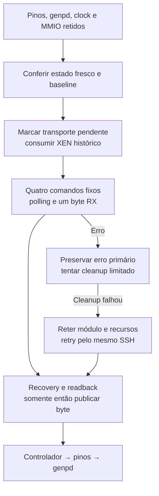

# Leitura limitada do controle HDQ do N71

## Estado e alcance

Preparação da [issue2](https://github.com/djalmajr/iphone6s-linux/issues/2): transporte em3e0a597 e caller em93da4be. O módulo operacional foi compilado, mas não carregado no aparelho. A nova ação lê somente o registro1d do endereço7bit75. Não programa limites de carga, escreve04/06 no SN2400, varre endereços ou identifica o gauge. Uma leitura pode retornar00/ff; esses bytes não comprovam presença, revisão ou unidade física de bateria.

[Plano e checklist](../.agents/plans/n71-i2c-hdq-read.md), [D40](../.agents/plans/n71-funcional-goal-decisoes.md#d40-consumir-a-indicação-de-conclusão-sem-inventar-sua-restauração), [prova sanitizada](evidence/n71-i2c-hdq-read-qualified.json). Os módulos anteriores e o Image power2 foram preservados. Nenhuma ação USB/SSH/DFU/reboot, instalação ou configuração global no Mac ocorreu nesta rodada.

## Transação e propriedade

O chamador qualifica o consumidor N71/I2C1, mantém descriptors114/115/default pinctrl, genpd ativo e clock/MMIO próprios. Antes de FIFO, a leitura exige o mesmo consumidor, relógio24MHz protegido, pinos conferidos, revisão2, IMASK0, XFSTA0, CTL0f/070f e baseline estável/idle. Só existe o alvo75:1d; não há parâmetro para trocar endereço, registro ou tamanho.

Na fonte PASemi preservada958481f, `drivers/i2c/busses/i2c-pasemi-core.c:286–295` usa byte-data com START/endereço de escrita, comando, repeated START/endereço de leitura e READ1/STOP. Os quatro comandos MTXFIFO são1ea,1d,1eb,601; MRXFIFO fornece um byte. Selecionar1d também transmite uma escrita no barramento: o acesso não é passivo. A referência N71 já lê1d no handshake HDQ, mas não qualifica automaticamente o estado físico atual ou a resposta de outro chip. [Fatos N71 selecionados](evidence/n71-hdq-charger-reference.json).



## Eventos consumíveis e recovery

SMSTA/XEN é a indicação de conclusão que o driver limpa por escrita. A baseline física histórica08010100 contém esse bit. Uma transação não pode prometer recriar esse evento; a baseline original permanece intacta, e status_acknowledged registra que a comparação final de SMSTA remove somente XEN. Sem transferência, o ciclo configure continua exigindo igualdade integral das cinco words.

O transporte usa no máximo100 esperas nominais1ms na espera de conclusão e na espera de bus idle. Isso não garante prazo absoluto se MMIO bloquear. Allones, RX vazio/fora da máscara, NACK, arbitration, timeout e jam/busy retornam erro. A saída só muda após leitura e recovery completos; erro primário e erro de cleanup permanecem distintos.

Cleanup aguarda XIP/JAM ausentes, confirma novamente o estado estável e recusa bits estrangeiros. Não reseta um bus que ficou ocupado depois do poll. Dados residuais, TX não vazio ou flags de erro podem exigir o reset FIFO CTL070f da fonte fixada. Acknowledge usa somente XEN/JMD/MTO/MTA/MTN/TOM. Readback precisa reproduzir os demais campos da baseline antes de liberar transporte; CTL/IMASK originais são restaurados pelo controlador depois. Falha conserva MMIO, clock, pinos, domínio e referência do módulo. `transfer_pending` impede release prematuro do controlador, mesmo se o chamador tentar fazê-lo.

## Uso operacional futuro

Estes são comandos para um boot Linux preparado e qualificado; não foram executados no telefone nesta rodada. Confira SHA, ELF e vermagic da candidata. O probe de compilação tem init ENODEV e não serve para uso operacional.

```sh
# No Linux do iPhone, pelo SSH do projeto:
insmod /caminho-conferido/n71-i2c-power-diagnostic.ko run=1
control=/sys/module/n71_i2c_power_diagnostic/parameters
cat "$control/status" "$control/configuration_status"
printf 'read-hdq-control\n' > "$control/action"
cat "$control/status" "$control/configuration_status"
dmesg | tail -30
```

`run=1` apenas qualifica no init. Não passar action no insmod: a ação depende do init concluído. A linha fresca N71_I2C_HDQ_CONTROL contém error, cleanup_error, valid, value, transfer_pending e transfer_error. `valid=1` qualifica o byte lido após cleanup do transporte; também exigir os dois erros0 e todos os estados finais limpos para aceitar o ciclo inteiro. Um cleanup posterior de genpd/pinos pode falhar mesmo com byte válido. Não usar last_saved de uma aquisição recusada como baseline nova.

Com pendência, manter SSH/objetos e tentar a ação abaixo; não remover o módulo, suspender o domínio ou forçar valores de GPIO/SMSTA/SN2400.

```sh
printf 'cleanup\n' > "$control/action"
cat "$control/status" "$control/configuration_status"
# rmmod somente após comprovar todos os recursos e obrigações limpos.
```

`cycle`, `inspect`, `configure`, o schema de status legado e o log configure anterior permanecem compatíveis. configuration_status acrescenta transfer_pending/transfer_error. A configuração foi extraída para um header próprio com referências aos estados existentes; o módulo tem275linhas. As ações podem ser repetidas no mesmo boot depois de cleanup completo.

## Provas e reprodução

| Gate | Resultado | Limite |
| --- | --- | --- |
| Transporte, Mac/ARM64 | 38cenários/12mutações por plataforma | Headers reais, MMIO/APIs sintéticos |
| Regressão do controlador, Mac/ARM64 | 50cenários/15mutações por plataforma | Contrato sem transferência preservado |
| Caller, Mac/ARM64 | 77cenários/23mutações por plataforma | Caller/configuração/genpd reais; dependências pins/controller/read sintéticas |
| Probe do transporte | 8.776bytes/3imports qualificados | Recusa load; não é operacional |
| Módulo operacional conjunto | 51.120bytes/79imports qualificados | W=1/Werror/modpost/ELF64-AArch64/vermagic power2; não carregado |
| Checkpatch estrito | 0erros/0avisos/0checks | Quatro fontes de produção afetadas |
| AST/lint fatal | Verdes em Mac/ARM64 | Sem type checker Python configurado |

Todas as mutações compilaram e falharam por SIGABRT/asserção. O teste de bus que fica busy depois do poll inicialmente antecipava o evento, deixando a mutação sobreviver; a fixture foi corrigida para retornar idle e só então mudar o estado observado pela amostragem. A mutação agora falha por asserção. Ajustes de alinhamento/comprimento foram verificados antes da build final; falhas de estilo ou compilação não contam como kills.

```sh
python3 -B tests/test_n71_i2c_controller.py
python3 -B tests/test_n71_i2c_hdq_read.py
python3 -B tests/test_n71_i2c_power_diagnostic.py
```

Na VM dedicada, copiar os dez inputs phone/kernel da prova para uma pasta nova de módulo e criar Makefile com `obj-m += n71-i2c-power-diagnostic.o` e `ccflags-y += -Werror`. Usar fonte/build preservados:

```sh
make -C /home/ubuntu/kernel-n71-binding-source-20261005 \
  O=/home/ubuntu/kernel-n71-binding-build-20261005 ARCH=arm64 -j2 \
  W=1 KCFLAGS=-Werror M=/caminho/novo/modulo \
  KBUILD_EXTRA_SYMBOLS=/home/ubuntu/kernel-n71-binding-build-20261005/vmlinux.symvers modules
```

Conferir os14 inputs Mac/ARM64/current, imports contra vmlinux.symvers, ELF/vermagic, SHA do módulo e config/Image/exports antes/depois. O aviso genérico de Module.symvers agregado ausente foi mantido, com exports reais fornecidos e nenhum import faltante; não se usou KBUILD_MODPOST_WARN. Provas privadas em runtime/n71-i2c-hdq-read-20261010 e runtime/n71-i2c-hdq-caller-20261010, diretórios700/arquivos600.

## CI e pendências

A correção de timeout foi aceita no headbe960f1, seis jobs verdes, e #41 foi fechada. A CI posterior e09bc845 falhou nos testes sintéticos por um único input histórico alterado, n71-i2c-power-diagnostic.c: copiar fonte atual com hash antigo invalidava o sandbox antes dos testes. A fixture1777a93 passou a gerar sua própria prova para os bytes copiados; guards/evidências de produção permanecem intactos. Oito módulos afetados passaram56testes e65mutações únicas por AssertionError em Mac/ARM64, com AST/lint fatal verdes. Isso não requalifica o binário Wi-Fi antigo contra código novo: sua seleção real ainda exige o snapshot original ou uma requalificação própria. A nova CI é um gate remoto separado.

Telemetria, arbitragem HDQ/UART5, ABI/revisão do gauge, carga líquida/sustentada e Wi-Fi nativo permanecem pendentes. Completar esses pré-requisitos e [preservar a proveniência do caller Wi-Fi — #43](https://github.com/djalmajr/iphone6s-linux/issues/43) antes de uma coleta física agrupada. O goal e #2/#9/#42 continuam abertos. Não é necessário ler/operar o console nem confirmar tela/cabo/temperatura durante o desenvolvimento.
